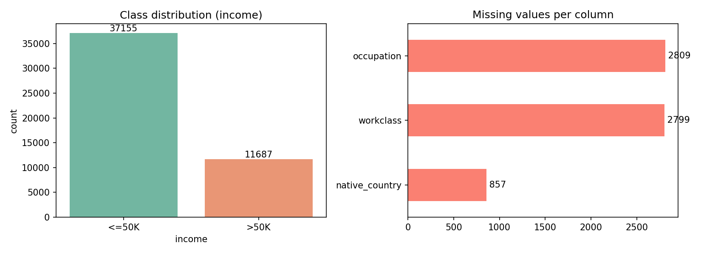
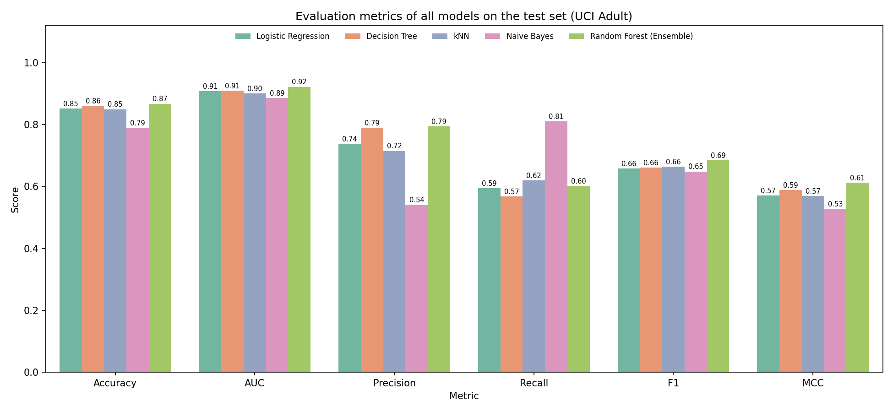
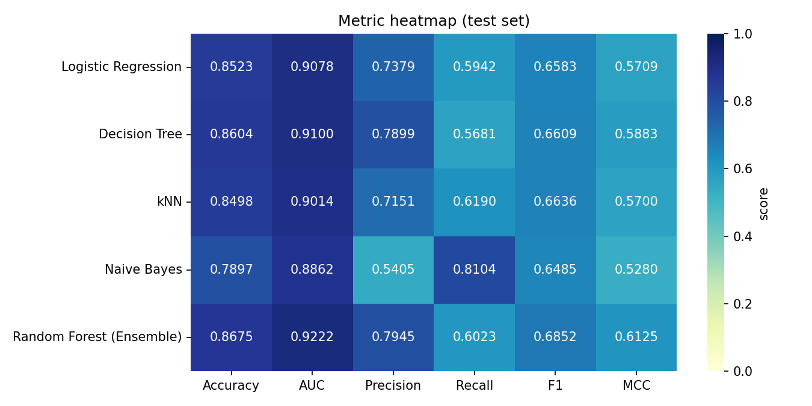
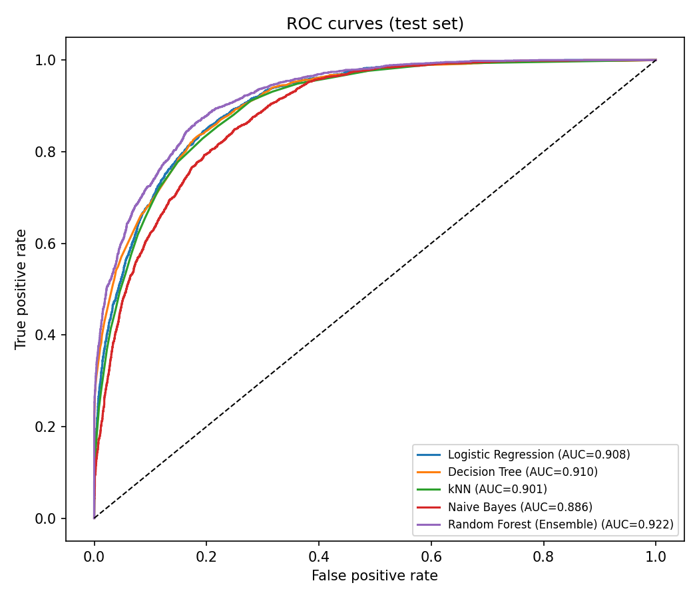
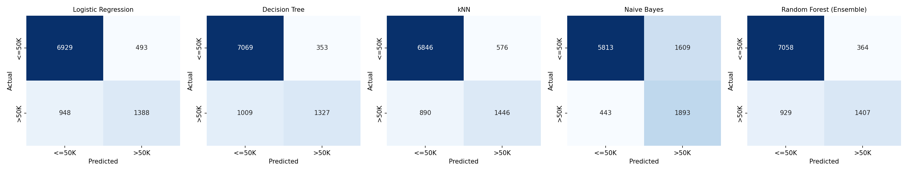

# ML Assignment 2 – Income Classification on the UCI Adult (Census Income) Dataset

## 1. Problem statement

Predict whether a person's annual income exceeds **USD 50,000** (`>50K`) or not (`<=50K`) from demographic and employment attributes recorded in the 1994 US Census. This is a **binary classification** problem.

Five classifiers – Logistic Regression, Decision Tree, k-Nearest Neighbours, Gaussian Naive Bayes and Random Forest (ensemble) – are trained on the same preprocessed data and compared using Accuracy, AUC, Precision, Recall, F1 and the Matthews Correlation Coefficient (MCC).

## 2. Dataset description

| Item | Value |
|---|---|
| Source | UCI Machine Learning Repository – [Adult / Census Income](https://archive.ics.uci.edu/dataset/2/adult) (Becker & Kohavi, 1996) |
| Instances | **48,842** (`adult.data` 32,561 + `adult.test` 16,281, combined) |
| Features | **14** (6 numeric, 8 categorical) |
| Target | `income` – `<=50K` (0) / `>50K` (1) |
| Missing values | **Yes** – `workclass` 2,799 (5.73%), `occupation` 2,809 (5.75%), `native_country` 857 (1.75%) – coded as `?` |
| Duplicates | 52 exact duplicate rows |
| Class balance | `<=50K` 37,155 (76.07%) vs `>50K` 11,687 (23.93%) → **imbalanced, ≈ 3.2 : 1** |

**Why this dataset?** It satisfies every requirement of the assignment (>12 features, >1,000 instances, genuine missing values, class imbalance), it mixes numeric and high-cardinality categorical features so that encoding and scaling actually matter, and it is a realistic socio-economic prediction task where the trade-off between precision and recall of the minority class is meaningful.

**Feature types**

| Feature | Type | Description |
|---|---|---|
| age | Numeric (int) | Age in years |
| workclass | Categorical (8) | Employer type – *has missing values* |
| fnlwgt | Numeric (int) | Census sampling weight |
| education | Categorical (16) | Highest education level (dropped – see preprocessing) |
| education_num | Numeric (ordinal int) | Education level as a number (1–16) |
| marital_status | Categorical (7) | Marital status |
| occupation | Categorical (14) | Occupation – *has missing values* |
| relationship | Categorical (6) | Role in household |
| race | Categorical (5) | Race |
| sex | Categorical (binary) | Sex |
| capital_gain | Numeric (int, highly skewed) | Capital gains |
| capital_loss | Numeric (int, highly skewed) | Capital losses |
| hours_per_week | Numeric (int) | Working hours per week |
| native_country | Categorical (41) | Country of origin – *has missing values* |



### Preprocessing

| Step | What was done |
|---|---|
| Missing values | `?` read as NaN. Categorical NaNs → **most-frequent** imputation; numeric → **median** imputation (defensive, numeric columns have no NaNs). |
| Duplicates | 52 exact duplicate rows removed → 48,790 rows. |
| Redundant feature | `education` dropped – it is a 1-to-1 text copy of `education_num` → **13 features used**. |
| Encoding | `OneHotEncoder` for the 7 categorical features (levels seen < 10 times grouped as *infrequent*, unseen levels at test time ignored). |
| Scaling | `StandardScaler` on numeric features for the scale-sensitive models (Logistic Regression, kNN, Naive Bayes). Tree-based models use unscaled features. |
| Split | **80 : 20** train/test (39,032 / 9,758), **stratified** on the target (23.94% positives in both), fixed seed `SEED = 2026`. |
| No leakage | Imputers, encoder and scaler are steps of an sklearn `Pipeline`, so they are **fitted only on the training data** (and only on the training folds during cross-validation). |
| Class imbalance | Examined (3.2 : 1). Handled with a stratified split / stratified CV and by using imbalance-robust metrics (AUC, F1, MCC) alongside accuracy; ROC-AUC is used as the tuning metric. |

## 3. GitHub repository link

**https://github.com/dsatishreddy/ml-assignment-2-classification**

```
ml-assignment-2-classification/
│-- README.md
│-- requirements.txt
│-- test_data.csv                 # the 20% held-out test split (9,758 rows, raw features + target)
│-- data/                         # original UCI files: adult.data, adult.test, adult.names
│-- model/
│   │-- ML_Assignment_2_Classification.ipynb   # full executed notebook (EDA → models → results)
│   │-- pipeline_utils.py         # loading, cleaning, split, preprocessing, metrics
│   │-- models.py                 # the 5 classifiers and their search grids
│   │-- train_models.py           # trains/tunes/evaluates/saves all models + plots
│   │-- predict.py                # reloads saved models and re-scores test_data.csv
│   └-- saved_models/             # *.pkl – fitted pipelines for all 5 models
└-- results/                      # metrics.csv, model_configs.json, plots
```

### How to run

```bash
git clone https://github.com/dsatishreddy/ml-assignment-2-classification.git
cd ml-assignment-2-classification
pip install -r requirements.txt

python model/train_models.py      # trains + evaluates all 5 models (~7 min on 2 CPUs), writes results/ and saved_models/
python model/predict.py           # reproduces the metrics from the saved .pkl models and test_data.csv

# or open the notebook
jupyter notebook model/ML_Assignment_2_Classification.ipynb
```

If the `data/` files are missing, they are downloaded automatically from UCI.

## 4. Models used

### Model configurations

Each model is a `Pipeline(preprocessor → classifier)`. Hyper-parameters were chosen by `GridSearchCV` (5-fold stratified CV on the training set, scoring = ROC-AUC); the best pipeline was refitted on the full training set and evaluated once on the test set.

| Model | Search grid | Selected hyper-parameters | CV ROC-AUC |
|---|---|---|---|
| Logistic Regression (lbfgs, max_iter=2000) | C ∈ {0.01, 0.1, 1, 10} | C = 0.1 | 0.9041 |
| Decision Tree | max_depth ∈ {6, 8, 10, 12}, min_samples_leaf ∈ {10, 30, 60}, criterion ∈ {gini, entropy} | gini, max_depth = 10, min_samples_leaf = 60 | 0.9044 |
| kNN | n_neighbors ∈ {11, 21, 31}, weights ∈ {uniform, distance} | k = 31, uniform | 0.8965 |
| Gaussian Naive Bayes | var_smoothing ∈ {1e-9, 1e-6, 1e-3, 1e-1} | var_smoothing = 0.1 | 0.8837 |
| Random Forest (300 trees) | max_depth ∈ {14, 20}, min_samples_leaf ∈ {2, 5}, max_features ∈ {sqrt, 0.3} | max_depth = 14, min_samples_leaf = 2, max_features = 0.3 | 0.9184 |

### Comparison table (test set, 9,758 rows; positive class = `>50K`)

| ML Model Name | Accuracy | AUC | Precision | Recall | F1 | MCC |
|---|---|---|---|---|---|---|
| Logistic Regression | 0.8523 | 0.9078 | 0.7379 | 0.5942 | 0.6583 | 0.5709 |
| Decision Tree | 0.8604 | 0.9100 | 0.7899 | 0.5681 | 0.6609 | 0.5883 |
| kNN | 0.8498 | 0.9014 | 0.7151 | 0.6190 | 0.6636 | 0.5700 |
| Naive Bayes | 0.7897 | 0.8862 | 0.5405 | **0.8104** | 0.6485 | 0.5280 |
| Random Forest (Ensemble) | **0.8675** | **0.9222** | **0.7945** | 0.6023 | **0.6852** | **0.6125** |

### Visualisation of the metrics









### Observations on model performance

| ML Model Name | Observation about model performance |
|---|---|
| Logistic Regression | Strong linear baseline: 85.2% accuracy and 0.908 AUC after one-hot encoding + scaling, showing that most of the signal (marital status/relationship, education, capital gain, age, hours) is close to linearly separable. Mild regularisation (C = 0.1) was best. Recall on `>50K` is only 0.59 because the default 0.5 threshold favours the majority class; it cannot model interactions such as *married × high education* without manual feature engineering. |
| Decision Tree | A depth-10 tree with ≥60 samples per leaf beat Logistic Regression on accuracy (86.0%), precision (0.79) and MCC (0.588) by capturing non-linear splits (e.g. capital_gain thresholds, relationship). Pruning was essential – deeper trees overfit. It is the most conservative model: lowest recall (0.57), i.e. it misses the most high-income people. Highly interpretable. |
| kNN | With k = 31 on scaled features it reaches 85.0% accuracy / 0.901 AUC and the 2nd-best recall (0.62), but the lowest AUC among the non-NB models. Distance in a ~90-dimensional mostly-binary one-hot space is less informative, it is sensitive to scaling, and prediction is slow because it stores all 39k training rows. |
| Naive Bayes | Lowest accuracy (79.0%), precision (0.54) and MCC (0.528): the feature-independence and Gaussian assumptions are violated (one-hot binaries, heavily skewed capital_gain/loss, correlated relationship/marital_status). It over-predicts `>50K`, giving by far the **highest recall (0.81)** – useful only if missing a high-income person is much costlier than a false alarm. Its ranking ability is still reasonable (AUC 0.886). Very fast to train. |
| Random Forest (Ensemble) | **Best on 5 of 6 metrics**: accuracy 86.8%, AUC 0.922, precision 0.79, F1 0.685, MCC 0.613. Averaging 300 de-correlated trees reduces the variance of a single tree while keeping its non-linear interactions. Its recall (0.60) is still limited by the class imbalance at the 0.5 threshold. Costliest model to tune (~5 min) and least interpretable. |

**Overall winner: Random Forest (Ensemble)** – highest Accuracy, AUC, Precision, F1 and MCC on the test set. MCC and F1 (which account for the 3.2 : 1 imbalance) confirm it is the most balanced classifier, not just the best on accuracy. Naive Bayes is preferable only when minority-class recall is the sole priority. For all models, recall could be traded up by lowering the decision threshold or using `class_weight="balanced"`.

## 5. Screenshot – execution on BITS Virtual Lab

_Add the screenshot of `python model/train_models.py` (or the executed notebook) running on BITS Virtual Lab here._
